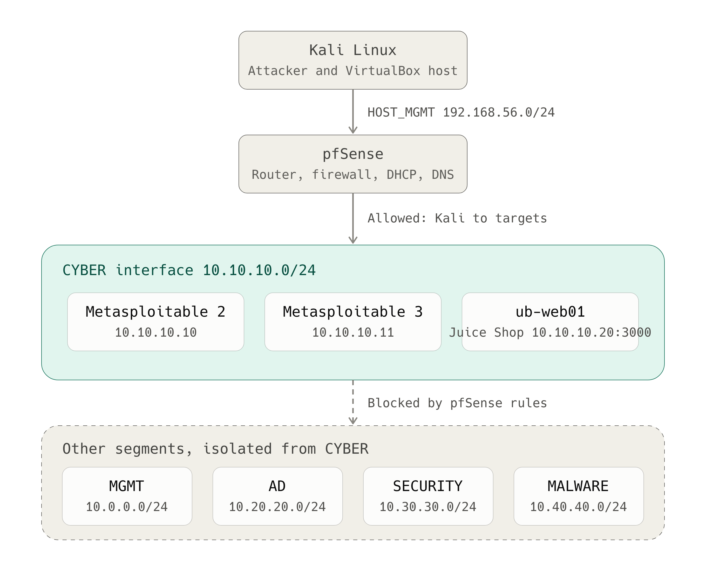

# Cyber Range Lab

An isolated cybersecurity lab built with **pfSense** and **VirtualBox**, featuring intentionally vulnerable machines and applications for penetration testing, vulnerability assessment and security research.

> **Warning:** This lab contains deliberately vulnerable systems. Never connect them to a production or personal network, and never expose them to the internet.

## Scope

- pfSense-based network segmentation
- Metasploitable 2 and 3 (vulnerable infrastructure targets)
- OWASP Juice Shop (vulnerable web application target)
- Network enumeration and vulnerability assessment
- Exploitation and privilege escalation
- Web application penetration testing

## Lab environment



| Component | Role |
|---|---|
| Kali Linux (host) | Attacker workstation and VirtualBox host |
| VirtualBox | Virtualization platform |
| pfSense | Central router and firewall |
| Metasploitable 2 | Vulnerable Linux target |
| Metasploitable 3 | Vulnerable multi-service target |
| OWASP Juice Shop | Vulnerable web application (Docker on Ubuntu) |

## Cyber Range targets

| Target | IP address | Documentation |
|---|---|---|
| Metasploitable 2 | `10.10.10.10` | [Targets/metasploitable-2.md](Targets/metasploitable-2.md) |
| Metasploitable 3 | `10.10.10.11` | [Targets/metasploitable-3.md](Targets/metasploitable-3.md) |
| OWASP Juice Shop (`ub-web01`) | `10.10.10.20:3000` | [Targets/owasp-juice-shop.md](Targets/owasp-juice-shop.md) |

## Repository structure

```
Cyber-Range/
├── README.md
├── Architecture/
│   ├── network-topology.md
│   └── ip-addressing.md
├── Targets/
│   ├── metasploitable-2.md
│   ├── metasploitable-3.md
│   └── owasp-juice-shop.md
└── Screenshots/
    ├── cyber_range_lab_network_flow.png
    └── juice-shop/
        ├── 01-ubuntu-server-installation.png
        ├── 02-ssh-login-ub-web.png
        ├── 03-docker-and-compose-version.png
        ├── 04-docker-hello-world-verify.png
        ├── 05-create-juice-shop-dir.png
        ├── 06-docker-compose-up.png
        ├── 07-docker-compose-ps.png
        ├── 08-docker-ps.png
        ├── 09-docker-logs-juice-shop.png
        └── 10-curl-localhost-verification.png
```

## Related project

OWASP Juice Shop is deployed here as a vulnerable web application target. The same application is planned to be reused in a separate **SafeLine WAF Lab** project, where it will also be reachable through a reverse-proxy WAF for protected-versus-unprotected comparison testing.

## Safety rules

1. The Cyber Range subnet is isolated by pfSense from Management, Active Directory and Malware Sandbox networks.
2. Vulnerable VMs use VirtualBox **Internal Network** only, never bridged.
3. Avoid unrestricted outbound internet access from vulnerable targets.
4. Take VirtualBox snapshots before and after major changes.
5. Never store real credentials or data on target machines.
