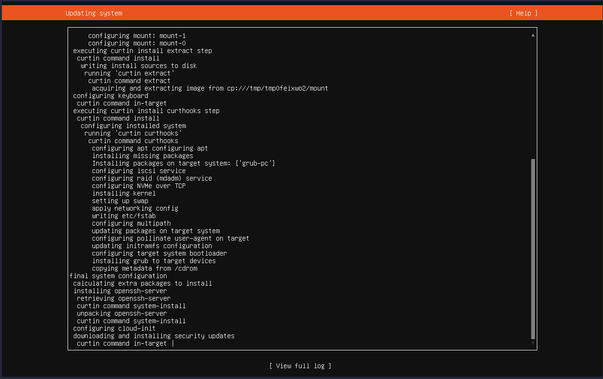
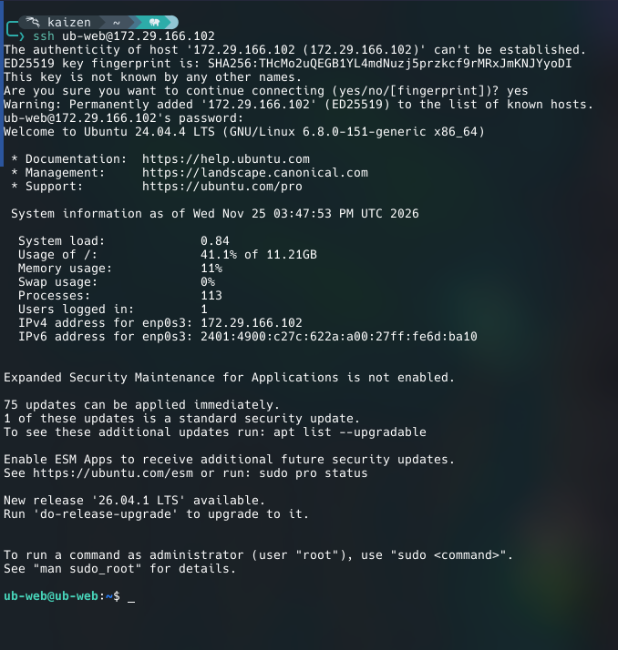
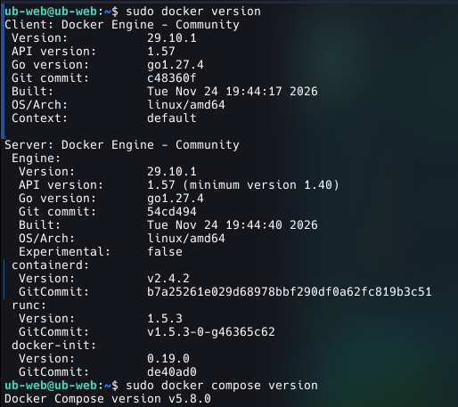
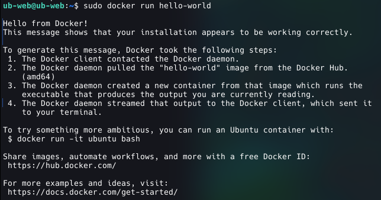
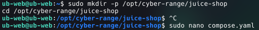
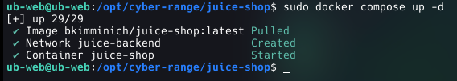
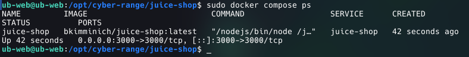
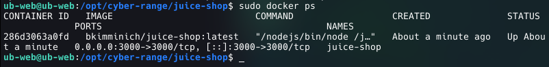
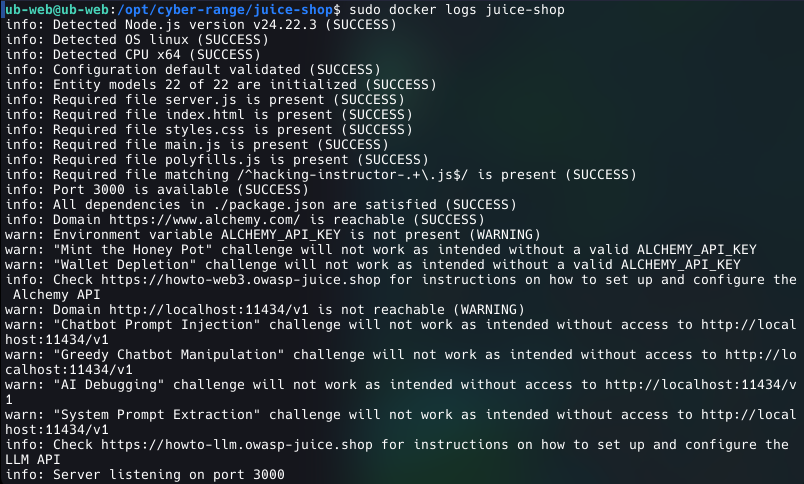
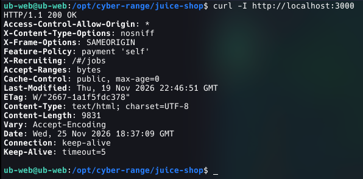

# OWASP Juice Shop Deployment

Step-by-step deployment of OWASP Juice Shop, an intentionally insecure web application, on an Ubuntu Server VM using Docker.

| Item | Value |
|---|---|
| VM name | `ub-web01` |
| OS | Ubuntu Server 24.04 LTS |
| IP address | `10.10.10.20/24` (static or DHCP-mapped) |
| Gateway | `10.10.10.1` |
| Application | OWASP Juice Shop (Docker) |
| Access URL | `http://10.10.10.20:3000` |
| Network | VirtualBox Internal Network (Cyber Range) |

> **Scope of this document:** standalone Juice Shop with direct access on port 3000. A SafeLine WAF is planned as a separate project; see [Future: SafeLine WAF](#future-safeline-waf).

## Contents

1. [Prerequisites](#1-prerequisites)
2. [Create the VM](#2-create-the-virtualbox-vm)
3. [Install Ubuntu Server](#3-install-ubuntu-server)
4. [Configure the static IP](#4-configure-the-static-ip)
5. [Prepare pfSense for setup](#5-prepare-pfsense-for-setup-temporary-internet-access)
6. [Update the system](#6-update-the-system)
7. [Install Docker](#7-install-docker-engine)
8. [Deploy Juice Shop](#8-deploy-juice-shop)
9. [Configure access from Kali](#9-configure-access-from-kali)
10. [Verify](#10-verify-the-deployment)
11. [Harden and snapshot](#11-lock-down-and-snapshot)
12. [Maintenance](#12-maintenance)
13. [Troubleshooting](#13-troubleshooting)

---

## 1. Prerequisites

- VirtualBox on the Kali host
- Ubuntu Server 24.04 LTS ISO
- pfSense running with the `CYBER` interface (`10.10.10.1`) configured and DHCP enabled (pool `10.10.10.100` to `10.10.10.200`)
- Kali able to reach pfSense over HOST_MGMT (`192.168.56.0/24`)
- Internet access through pfSense (temporary, for packages and the Docker image)

## 2. Create the VirtualBox VM

1. **Machine > New**
2. Name: `ub-web01`
3. ISO image: Ubuntu Server 24.04 LTS
4. Check **Skip Unattended Installation**
5. Hardware: **2 CPUs**, **2048 MB RAM** (use 4096 MB if you plan to add SafeLine later)
6. Hard disk: **25 GB**, dynamically allocated

Then open **Settings > Network > Adapter 1**:

| Setting | Value |
|---|---|
| Attached to | Internal Network |
| Name | `<CYBER_RANGE_NETWORK_NAME>` (exactly as used by pfSense) |
| Promiscuous Mode | Deny |
| Cable Connected | Enabled |

Do not use Bridged mode.

## 3. Install Ubuntu Server

Boot the VM from the ISO and follow the installer:

1. Language and keyboard: choose your preference.
2. Installation type: **Ubuntu Server** (minimized not required).
3. Network: leave the default. Because DHCP is enabled on `CYBER`, the VM will probably receive a temporary address from the `10.10.10.100` to `10.10.10.200` pool. You will set the permanent `10.10.10.20` address in the next step.
4. Proxy and mirror: leave defaults.
5. Storage: use the entire disk (default layout).
6. Profile setup:
   - Your name: your choice
   - Server name: `ub-web01`
   - Username and a **strong password**
7. **Install OpenSSH server**: enable (recommended for administration from Kali).
8. Featured snaps: select **none**.
9. Wait for installation, then **Reboot Now** and remove the ISO when prompted.



Log in with the user you created.

## 4. Configure the IP address

`ub-web01` must keep `10.10.10.20`. The `CYBER` DHCP pool is `10.10.10.100` to `10.10.10.200`, so `.20` is outside it and will never be handed to another VM. Choose **one** method:

| Method | Summary |
|---|---|
| **A. Static IP in Ubuntu (default)** | Configure netplan as below. Works even if pfSense DHCP is down. |
| **B. DHCP static mapping in pfSense** | Keep the VM on DHCP and bind its MAC to `10.10.10.20`. See [Method B](#method-b-dhcp-static-mapping-in-pfsense). |

### Method A: static IP in Ubuntu

Identify the interface name:

```bash
ip -br link
```

The interface is typically `enp0s3`. Check the existing netplan files:

```bash
ls /etc/netplan/
```

Edit the file listed (commonly `50-cloud-init.yaml` or `00-installer-config.yaml`):

```bash
sudo nano /etc/netplan/50-cloud-init.yaml
```

Replace the contents with (match indentation exactly, using spaces):

```yaml
network:
  version: 2
  ethernets:
    enp0s3:
      dhcp4: false
      addresses:
        - 10.10.10.20/24
      routes:
        - to: default
          via: 10.10.10.1
      nameservers:
        addresses:
          - 10.10.10.1
```

Secure and test the configuration:

```bash
sudo chmod 600 /etc/netplan/50-cloud-init.yaml
sudo netplan try
```

Press **Enter** to accept when prompted. If the change fails, netplan reverts automatically.

Stop cloud-init from overwriting the file on reboot:

```bash
echo 'network: {config: disabled}' | sudo tee /etc/cloud/cloud.cfg.d/99-disable-network-config.cfg
```

Verify:

```bash
ip addr show enp0s3
ip route
ping -c 4 10.10.10.1
```

Expected: address `10.10.10.20/24`, default route via `10.10.10.1`, and successful pings to pfSense.

### Method B: DHCP static mapping in pfSense

Use this instead of Method A, not in addition to it.

1. Find the VM's MAC address in VirtualBox: **Settings > Network > Adapter 1 > Advanced**, or in Ubuntu with `ip -br link`.
2. In pfSense, go to **Services > DHCP Server > CYBER > Static Mappings > Add**.
3. Enter:

| Field | Value |
|---|---|
| MAC Address | `<VM_MAC_ADDRESS>` |
| IP Address | `10.10.10.20` |
| Hostname | `ub-web01` |
| Description | Juice Shop host (later SafeLine) |

4. Save and apply changes.
5. On the VM, use DHCP in netplan:

```yaml
network:
  version: 2
  ethernets:
    enp0s3:
      dhcp4: true
```

```bash
sudo chmod 600 /etc/netplan/50-cloud-init.yaml
sudo netplan apply
ip addr show enp0s3
```

Expected: the VM receives `10.10.10.20/24`, gateway `10.10.10.1` and DNS `10.10.10.1` from pfSense. If it shows an address in the `.100` to `.200` pool, the MAC address does not match the mapping.

> The VirtualBox MAC address must stay the same. If you clone the VM or regenerate the adapter MAC, update the pfSense mapping.

## 5. Prepare pfSense for setup (temporary internet access)

The VM needs outbound access for updates and the Docker image. On the pfSense **`CYBER` interface**, temporarily allow:

| Source | Destination | Port | Action |
|---|---|---|---|
| `10.10.10.20` | `10.10.10.1` | TCP/UDP 53 | Allow (DNS) |
| `10.10.10.20` | Any | TCP 80, 443 | Allow (temporary) |

Because the destination is "Any", keep the block rules for `MGMT`, `AD`, `SECURITY` and `MALWARE` **above** this rule so those networks stay blocked.

Also confirm DNS works through pfSense (the DHCP scope already offers `10.10.10.1`) and that pfSense outbound NAT covers `10.10.10.0/24` (Firewall > NAT > Outbound; automatic mode normally does this).

Test from the VM:

```bash
ping -c 4 8.8.8.8
nslookup download.docker.com
```

> If `ping` is blocked but DNS and HTTPS work, that is acceptable. Test with `curl -I https://download.docker.com`.

## 6. Update the system

```bash
sudo apt update
sudo apt upgrade -y
sudo reboot
```

Log back in and install basic tools:

```bash
sudo apt install -y curl wget git vim nano net-tools ca-certificates gnupg
```

Optional: from Kali you can now connect over SSH once the Kali route and pfSense rules are in place (see step 9):

```bash
ssh <USERNAME>@10.10.10.20
```



## 7. Install Docker Engine

Use the official Docker repository.

```bash
sudo apt install -y ca-certificates curl
sudo install -m 0755 -d /etc/apt/keyrings
sudo curl -fsSL https://download.docker.com/linux/ubuntu/gpg -o /etc/apt/keyrings/docker.asc
sudo chmod a+r /etc/apt/keyrings/docker.asc
```

Add the repository:

```bash
echo \
  "deb [arch=$(dpkg --print-architecture) signed-by=/etc/apt/keyrings/docker.asc] \
  https://download.docker.com/linux/ubuntu \
  $(. /etc/os-release && echo "${UBUNTU_CODENAME:-$VERSION_CODENAME}") stable" | \
  sudo tee /etc/apt/sources.list.d/docker.list > /dev/null
```

Install Docker:

```bash
sudo apt update
sudo apt install -y docker-ce docker-ce-cli containerd.io docker-buildx-plugin docker-compose-plugin
sudo systemctl enable --now docker
```

Verify:

```bash
sudo docker version
sudo docker compose version
sudo docker run hello-world
```



Expected: the hello-world container prints a confirmation message.



> Optional: add your user to the `docker` group to avoid `sudo`: `sudo usermod -aG docker $USER`, then log out and back in. Note this gives the user root-equivalent access on the VM.

## 8. Deploy Juice Shop

Create the project directory:

```bash
sudo mkdir -p /opt/cyber-range/juice-shop
cd /opt/cyber-range/juice-shop
```



Create the Compose file:

```bash
sudo nano compose.yaml
```

```yaml
services:
  juice-shop:
    image: bkimminich/juice-shop:latest
    container_name: juice-shop
    restart: unless-stopped
    ports:
      - "3000:3000"
    networks:
      - juice-net

networks:
  juice-net:
    name: juice-backend
    driver: bridge
```

What the key settings do:

| Setting | Purpose |
|---|---|
| `image` | Official Juice Shop image from Docker Hub |
| `container_name` | Fixed name for logs and later integration |
| `restart: unless-stopped` | Starts automatically after a reboot |
| `ports: "3000:3000"` | Publishes the app on the VM's port 3000 (direct access) |
| `networks` | Dedicated bridge network, reusable later for a WAF |

Start the application:

```bash
sudo docker compose up -d
```



The first run downloads the image. Check status:

```bash
sudo docker compose ps
sudo docker ps
sudo docker logs juice-shop
```







Expected: the container is `Up`, and the log shows the server listening on port 3000.

Test locally on the VM:

```bash
curl -I http://localhost:3000
```



Expected: `HTTP/1.1 200 OK`.

## 9. Configure access from Kali

### 9.1 Route on Kali

Kali reaches the Cyber Range through pfSense. Add a route:

```bash
sudo ip route add 10.10.10.0/24 via <PFSENSE_HOST_MGMT_IP>
```

This is not persistent across reboots. To make it persistent, add it to your network manager configuration.

### 9.2 pfSense rule on the `HOST_MGMT` interface

Traffic from Kali enters pfSense on the `HOST_MGMT` interface, so the rule goes there (not on the `CYBER` interface):

| Setting | Value |
|---|---|
| Interface | `HOST_MGMT` |
| Action | Pass |
| Protocol | TCP |
| Source | `<KALI_HOST_MGMT_IP>` |
| Destination | `10.10.10.20` |
| Destination port | `3000` |
| Description | Kali to Juice Shop (direct) |

Optionally add a rule for TCP 22 if you want SSH from Kali.

Apply changes in pfSense.

## 10. Verify the deployment

From Kali:

```bash
ping -c 4 10.10.10.20
curl -I http://10.10.10.20:3000
nmap -sV -p 3000 10.10.10.20
```

Open `http://10.10.10.20:3000` in the Kali browser. The Juice Shop storefront should load.

Checklist:

- [ ] VM boots and keeps the static IP after reboot
- [ ] VM reaches pfSense (`10.10.10.1`)
- [ ] Docker and Compose work
- [ ] `juice-shop` container is `Up`
- [ ] Kali reaches `http://10.10.10.20:3000`
- [ ] `CYBER` cannot reach `MGMT`, `AD`, `SECURITY` or `MALWARE`
- [ ] Reboot test passes (container restarts automatically)

## 11. Lock down and snapshot

1. **Remove temporary internet access.** Delete or disable the outbound TCP 80/443 rule from `10.10.10.20` on the `CYBER` interface once installation is complete. Re-enable only when updates are required.
2. **Keep isolation rules** to `MGMT`, `AD`, `SECURITY` and `MALWARE` in place.
3. **Port 3000 note:** Docker publishes ports through its own firewall rules, so `ufw deny 3000` on the VM will not block it. Control access to port 3000 on pfSense.
4. **Snapshot:** shut down cleanly (`sudo shutdown now`) and take a VirtualBox snapshot named `juice-shop-standalone`.

## 12. Maintenance

| Task | Command |
|---|---|
| Start | `cd /opt/cyber-range/juice-shop && sudo docker compose up -d` |
| Stop | `sudo docker compose down` |
| Restart (resets challenge progress and data) | `sudo docker compose restart` |
| View logs | `sudo docker logs -f juice-shop` |
| Update image | `sudo docker compose pull && sudo docker compose up -d` |
| Resource usage | `sudo docker stats` |

Juice Shop keeps its state inside the container by default, so recreating it returns the application to a clean state.

## 13. Troubleshooting

| Problem | Likely cause | Check |
|---|---|---|
| VM has no network | Wrong Internal Network name | Compare VirtualBox adapter name with the pfSense `CYBER` adapter |
| Cannot ping `10.10.10.1` | Interface name or netplan error | `ip -br link`, `sudo netplan try` |
| VM gets a `.100` to `.200` address instead of `.20` | DHCP mapping MAC mismatch (Method B) | Compare MAC in VirtualBox with the pfSense mapping |
| `apt` or Docker download fails | No outbound rule, NAT or DNS | pfSense rules, `nslookup download.docker.com` |
| Netplan changes lost after reboot | cloud-init overwriting | Step 4 cloud-init disable file |
| Container not running | Startup error | `sudo docker ps -a`, `sudo docker logs juice-shop` |
| `curl localhost:3000` works but Kali cannot connect | Missing route or pfSense rule | Kali `ip route`, `HOST_MGMT` rule, pfSense firewall logs |
| Port 3000 already in use | Another service bound to 3000 | `sudo ss -tulpn \| grep 3000` |
| Slow or crashing VM | Low RAM | `free -h`, increase VM RAM |

Useful commands:

```bash
free -h
df -h
sudo docker ps -a
sudo docker network ls
sudo ss -tulpn
```

## Future: SafeLine WAF

A separate project (**SafeLine-WAF-Lab**) will place a reverse-proxy WAF in front of this same Juice Shop instance on `ub-web01`. The direct path (`http://10.10.10.20:3000`) will stay available as the unprotected baseline, and the WAF path will provide the protected comparison. That work is documented in the SafeLine repository, not here.

## References

- OWASP Juice Shop: https://owasp.org/www-project-juice-shop/
- Juice Shop companion guide: https://pwning.owasp-juice.shop/
- Docker on Ubuntu: https://docs.docker.com/engine/install/ubuntu/
- Netplan: https://netplan.readthedocs.io/
